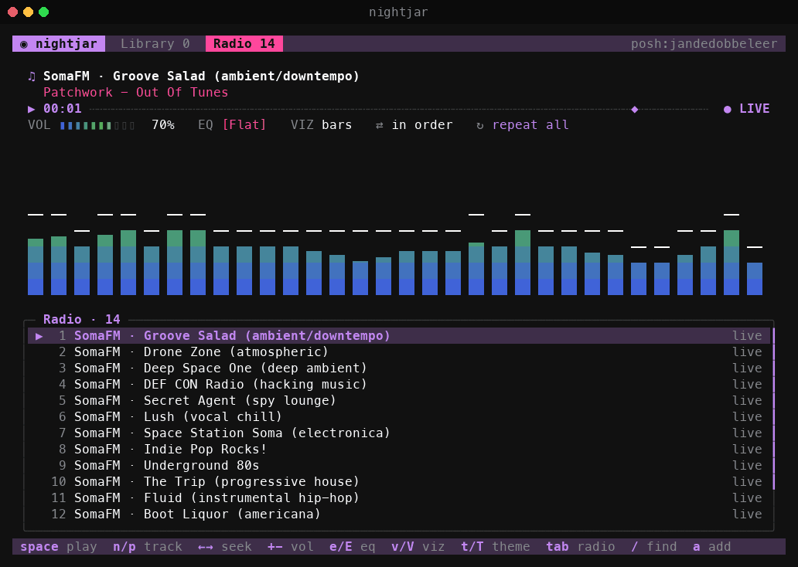
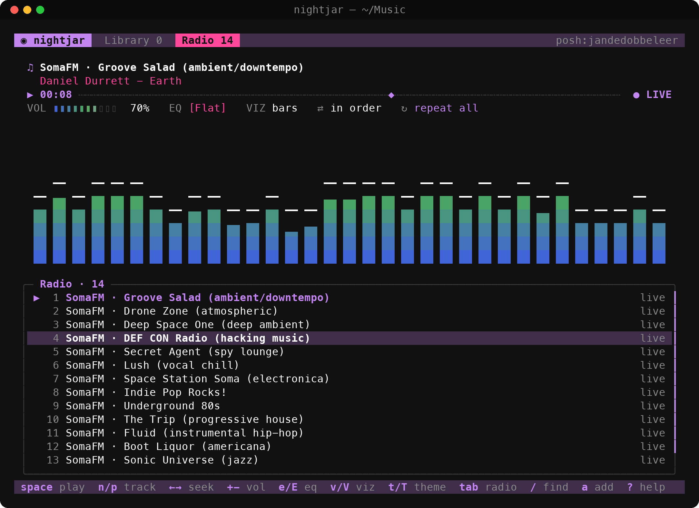

# nightjar

A terminal audio player: live FFT visualizers, a 10-band EQ, internet radio, gapless
playback, and themes, including any **oh-my-posh** theme.



## Install

Linux only. Audio goes out through PipeWire, PulseAudio or ALSA.

1. Install the dependencies: Python 3.11+, numpy and ffmpeg.

   ```sh
   sudo pacman -S python-numpy ffmpeg                  # Arch
   sudo apt install python3-numpy ffmpeg pipewire-bin  # Debian / Ubuntu
   sudo dnf install python3-numpy ffmpeg-free          # Fedora
   ```

2. Download the script onto your PATH:

   ```sh
   mkdir -p ~/.local/bin
   curl -fL https://github.com/scotbeachell-lab/nightjar/releases/latest/download/nightjar.py \
     -o ~/.local/bin/nightjar && chmod +x ~/.local/bin/nightjar
   ```

3. Optionally, fetch the oh-my-posh themes, then play:

   ```sh
   nightjar --fetch-posh-themes
   nightjar ~/Music
   ```

## Usage

```sh
nightjar ~/Music              # folders, files, .m3u/.pls, or stream URLs
nightjar --fetch-posh-themes  # grab the official oh-my-posh theme pack (~125)
nightjar --posh ~/.config/oh-my-posh/mytheme.omp.json
nightjar --list-themes
```

## oh-my-posh themes

Themes are discovered from `~/.config/nightjar/posh-themes`, `$POSH_THEMES_PATH`,
`~/.cache/oh-my-posh/themes`, `~/.poshthemes`, `~/.config/oh-my-posh`, and your active
`$POSH_THEME`. JSON and TOML are fully parsed (palettes, `p:` references, templates,
inline `<#hex>` tags); YAML is scanned line by line. The segment colors become the
player palette: the first vivid segment color is the accent, and the distinct segment
colors, sorted dark to bright, make up the visualizer gradient.



Press `T` for the theme picker (type to filter, live preview) and `B` to use your
terminal's own background.

## Keys

| key | action | key | action |
|---|---|---|---|
| space | play / pause | enter | play selected |
| n / p | next / previous | ← → (shift) | seek 5s (30s) |
| + - m | volume / mute | tab | Library ⇄ Radio |
| e / E | EQ preset / editor | v / V | visualizer / fullscreen |
| t / T | next theme / picker | s / r | shuffle / repeat |
| / | find | a | add file, folder or URL |
| A | queue next | d | remove |
| w | save .m3u | ? | help |

Visualizers: bars, mirror, led, dots (braille), scope, fire, vu.

Settings are saved to `~/.config/nightjar/config.json`. Put your own radio list in
`~/.config/nightjar/stations.m3u` (use `#EXTINF:-1,Name` lines for names).

## License

MIT. See [LICENSE](LICENSE).
